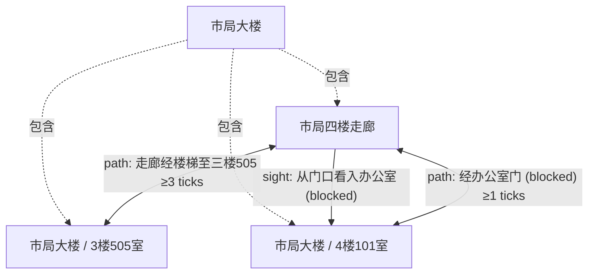

# 办公室局部地图示例

根据 [空间约定样例](../assets/spatial.example.json) 经实际 map 命令导出；这是作者约定初态（第 0 章），不是新创作章节的文学评价。图为局部拓扑，不按比例。

局长办公室绑定四楼 101；三楼 505 是另一个物理房间。周行在办公室内，宋禾在走廊，钥匙由周行携带。门当前关闭，因此通行与向内看均受阻；开门后，视线还要求室内灯亮。

样例用分钟作时钟单位，图中的 ticks 即分钟；耗时仅是本示例约定，不是现实建筑测量值。未登记声音连接，不能从视线推导“听见”。

[完整机器可读地图](spatial-map.json)保留稳定 ID、来源、用途绑定、位置和条件；[使用与局限](../references/spatial-continuity.md)。
