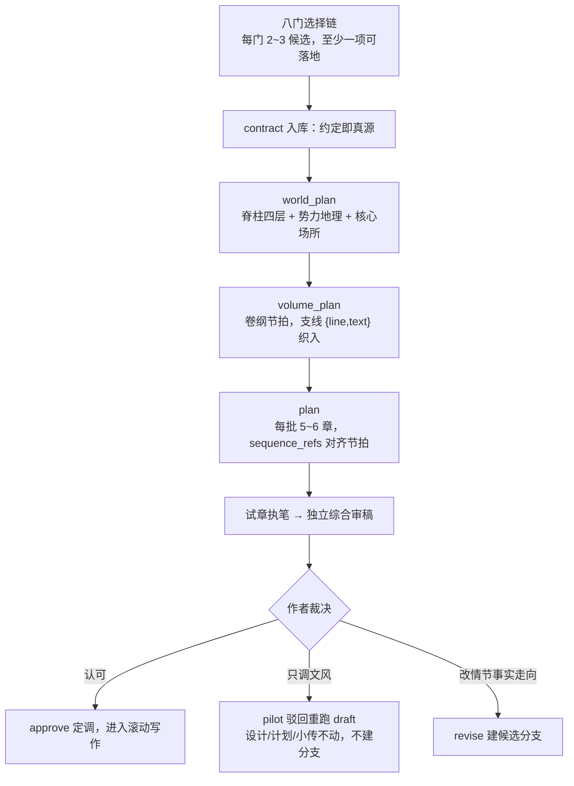

# 开书与滚动规划
何时读：开新书——八门选择链、人物命名、分层设计流转与篇幅预算。

## 八门选择链

缺方向时每轮推进一道门，给 2～3 个因果不同的候选。作者可回复 `A/B/C`、`换一组`、`自定义` 或 `返回`；选后推导字段入库。

候选含至少一个可落地、能支撑长篇的高概念脑爆项，写清收益、代价与风险，不能只换名字或数值。换组时按 [创意工具箱](hatch-ideas.md) 切换透镜。卷纲方向与关键拍也按此裁决，choice_log.candidates 至少一项 `wild:true`。

题材与系统机制隔离：本技能用数据库管理事实只是工程机制，其工程用语不是题材素材；候选概念、书名、设定与命名默认不向账务、债务、清算类意象倾斜，除非作者点名的题材本身需要。

| 门 | 决策内容 | 映射约定字段 |
|---|---|---|
| 1 读者承诺 | 题材定位、核心看点、一句话高概念 | `reader_promise` |
| 2 推进引擎 | 核心驱动力与全书各卷职责 | `arcs` 节点 |
| 3 主角设定 | 主角行动逻辑、欲望与底线 | `protagonist_drive` 与主角实体 |
| 4 核心关系 | 驱动故事的人际或对抗关系（可为 `none`） | 人物线与 `arcs` |
| 5 世界对抗 | 世界运行秩序、资源限制与核心压力 | `world_rules` |
| 6 机制设定 | 特殊机制原理、代价与失效条件（可为 `none`） | `world_rules` |
| 7 终局节点 | 终局事实与 4～8 个核心因果节点 | `ending` 与 `arcs` 脊柱 |
| 8 体量文风 | 分卷预算、通常章篇幅（可不设）与文风锚点 | `volumes[].word_budget`、`word_range`、可选 `chapter_target_han`、`style` |

第 8 门将 [声线通用规则](voices.md) 写入 style.traits，试章照此执笔和审稿。

## 人物命名

- 名字契合阶层、出身与行当，避免无依据的模板名或成名作主角同名。
- 定名前 `recall --entity <名字>` 查重；外号通过 alias 登记。

## 契约改订（init 之后）

契约在 `init` 时整体入账，之后作者要改（换主角名、删一条风格红线、改读者承诺）用 `recontract` 原地改订，**不要删除 `novel.sqlite3` 重新 init**——那会丢掉全部任务历史并迫使每个规划 Worker 重跑：

```bash
python3 "$ROOT/scripts/novel.py" recontract --project "$PROJECT" --contract contract.json --reason "主角改名"
```

- **实体改名**（同 id 同 kind，name/alias 文本变化）：旧名按映射全局替换进契约、已存设计、人物档案与章计划，记录哈希同步重算，规划与档案**无需重跑**，流水线从当前阶段继续。
- **结构性变更**（实体增删、卷 ID、初始事实/关系/资源、规划模式）：受影响设计层标记失效、未写计划清理，`advance` 重新派发对应阶段；任务与日志历史保留。
- **方向性条款**（world_rules/arcs/ending/reader_promise 等）：原样更新并提示；已提交设计是旧方向下的提案，实质转向用 `replan` 重跑受影响层，小改动由后续任务吸收。
- **守卫**：有 pending 任务先完成或取消；已有正文或候选稿时拒绝——落笔后的改动走 `pilot`/`revise` 修订流程。`config` 设置过的 `chapter_target_han`/`character_views` 在新契约未提及时自动保留。

写契约文件时若宿主写入工具报「file no longer exists / FS_STALE_VERSION」（文件曾被外部删除）：对同一文件**执行一次 read**（404 也算，这一步重置版本跟踪），再重试 write；不要用 Test-Path/glob 代替，也不需要先写占位文件。仍失败时用 Python 脚本 `encoding="utf-8"` 写入，不用 PowerShell `>` 重定向。

## 分层世界设计与卷纲推进

按 [分层设计](design-and-brief.md) 顺序流转：
1. **全书世界设计（`world_plan`）**：确定核心势力、地理与底层规则；
2. **分卷设计（`volume_plan`）**：明确本卷要改变的局面、付出的代价与交接压力；sequence 用支线节拍（`{line,text}` 引用脊柱触点）把 subplot/tension 织进主线因果序，避免整卷单线推土；
3. **分批章节计划（`plan`）**：每次细化未来 5～6 章的 `goal/conflict/change/entities/scenes`；
4. **试章定调**：首章通过事实与读者两类检查后交作者（新项目默认由独立综合审稿者一次完成）。认可后 `approve`；只调文风（形容词密度、章末处理等表达层意见）用 `pilot --reason "<意见>"` 驳回重写，设计、计划与小传原样保留，直接重跑 draft——不建分支；要改情节、事实或走向才 `revise`。



## 篇幅预算与滚动扩纲

- **卷字数分配**：新书在 `volumes[].word_budget` 中分配各卷参考汉字数，合计需落入全书 `word_range`。
- **预算自适应**：通过 `status` 查看各卷实际字数与偏差，后卷根据未写剧情动态平衡空间，避免终局草率收尾。
- **章篇幅**：用 contract.chapter_target_han 约定，或无 pending 时 `config --key chapter_target_han --value 3000`（示例值）。未设时按场景估计目标与依据；刻意短章事先说明作用，不因短稿降标。
- **展开与呼吸**：按 [章纲展开与节奏](design-and-brief.md) 准备 execution/rhythm，核对连续章节的推进、兑现和余波。
- **重规划**：`replan --reason ...` 清理未写计划并重新细化，已入库正文不变。
