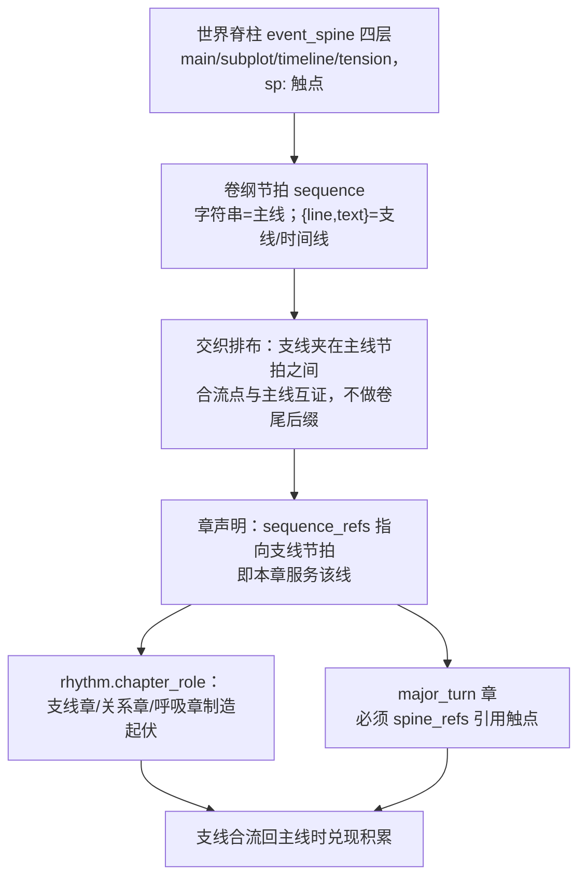

# 分层设计与场景任务书
何时读：world_plan/volume_plan/plan 回执字段与 writer_brief、execution/rhythm。

planning_mode=layered 按 world_plan → volume_plan → plan 流转，生成 writer_brief。

## 三级设计结构

| 层次 | 阶段标识 | 核心交付物 |
|---|---|---|
| **全书设计** | `world_plan` | 核心规则、势力限制、大地理区域、四层事件脊柱（`event_spine`）、终局依赖 |
| **分卷设计** | `volume_plan` | 本卷区域与场所布局、因果序列（`sequence`）、卷纲三件套（`carries_in/climax/handoff`）、裁决留痕（`choice_log`） |
| **章节计划** | `plan` | 未来 5～6 章的读者体验、推进节拍、人物选择、场景展开依据、压力变化及前后承接 |

## 约束分层原则

1. **创作约定（contract）**：全书总约束，包含字数区间、文风红线与终局方向，不可被设计提案擅自修改。
2. **客观事实账本（SQLite）**：已入库的有效正文事件、人物站位、资产流水与地图。
3. **未来设计提案（`proposal_not_canon`）**：未入库的候选布局与剧情设想，可调整，但不能覆盖已发生事实。

文风修订继承已有设计时，`source_branch` 保留设计证据的原始分支，`sources` 继续核对原稿哈希；修订提升后仍保留该来源，不将改稿冒充为原设计证据。任务选入的这类 `required_chapter` 标明来源 `branch`，只用于核验设计依据；当前事实和审稿证据仍以任务分支为准。修订期间尚未重写的章节所确立的事实引用可按原来源核对，当前账本已有的冲突值不会被原稿覆盖。普通事实/因果修订仍使受影响设计失效。

## 设计回执规范

### world_plan.data
- `overview`：世界支撑全书核心体验的简要说明。
- `causal_spine`：主要因果节点字符串数组（必填非空）。
- `event_spine`：四层事件脊柱（`main` / `subplot` / `timeline` / `tension`），触点格式 `{"id":"sp:...","span":"幕跨度","event":"触点推进"}`。重大转折必须引用脊柱触点。
- `factions`：势力组织数组（`name/drive/limits`）。这里的势力是设计意图；需要账目级管理的势力（阵营战争、粮饷军械、结盟与背叛）应注册为 entity（kind 如 org），粮饷兵力走 `resource` 流水，阵营间立场用 `relation` 有向边登记——设计层写目标，账本层记事实，两层不混。
- `geography`：宏观区域 `regions` 与连接 `connections`。
- `core_locations`：候选场所数组（`id/name/purpose`，可选 `canon_place`）。
- `ending_dependencies`：终局所需的空间、机制或关系前置条件。

### volume_plan.data
- `volume`：卷 ID，与任务一致。
- `purpose`：本卷用途（必填非空）。
- `carries_in` / `climax` / `handoff`：承接上卷债务、本卷高潮走向与下卷交接说明。
- `sequence`：因果推进节拍数组。字符串为主线节拍；支线/时间线节拍用 `{"line":"sp:触点ID","text":"节拍"}` 声明服务线，夹在主线节拍之间交织排布——支线在对应主线触点前后切入并合流，不是平铺在卷尾的后缀。
- `choice_log`：方向与关键节拍裁决。按 [创意工具箱](hatch-ideas.md) 给至少 2 个候选，含至少一个 wild:true；每项 direction/payoff/cost/risk，记录 chosen/reason。

卷纲说明冲突、选择和后果如何承载预算。sequence/sequence_refs 是导航，编号用完不等于展开充分。多线卷把 subplot/tension 触点织进 sequence：支线节拍穿插在主线节拍之间，合流点与主线互证，避免整卷单线推土；章以 sequence_refs 指向支线节拍即声明本章服务该线。volume_end 前结合正文和 volume_budget 核对过程、代价与余波；偏离时说明原因及后卷承载，不机械移预算或补字。



## 场景任务书（writer_brief）

章计划（`plan`）通过后，引擎自动为执笔任务生成 `writer_brief` 并派生 `brief_path`：

```text
创作任务：reader_experience（情感期待）、goal、conflict、change
节拍推进：sequence_refs（对应的卷纲节拍序号；指向支线节拍即声明本章服务该支线）
收束形态：ending_shape（类别:说明；闭环/交接/爆发/静收/反转/余波，可因剧情连续使用；章尾不加悬念钩子，收束落在行动、抉择或后果的自然完成上）
人物选择：character_choices（entity/desire/pressure/choice/cost）
场景提案：scenes（地点、拟在场者、intent/conflict/turn、动作与感知限制）
展开依据：execution（目标依据、展开单元及各自作用）
节奏安排：rhythm（本章作用、压力变化原因、呼吸落点与前后承接）
表达空间：expression_space
```

topics 与 dialogue_intents.knowledge_topics 列本章需用或核验的认知；dependencies 只列必要原章，不漏行动前提。

## 章纲展开与节奏

新章纲提供 execution/rhythm，旧章纲兼容。通常目标取 contract.chapter_target_han；未设时按场景估 execution.target_han，并写 target_reason。目标不是上限，不均分全书字数、不按事件数算；刻意短章事先说明作用与原因。

execution.expansion_units 每项含 id/scene/focus/development/expected_change；scene 从 1 起，可选正数 weight 表相对注意力。同场景可多单元，无需新增账本事件。development 写阻力和演出方法，expected_change 写删后损失。spare_options 为有因果依据的备用展开；scene.dramatization 为动作、试探与潜台词提示字符串数组。

`rhythm` 含：

- `chapter_role`：本章对当前段落的作用，具体到蓄势、推进、兑现或处理后果；不强制采用固定角色列表。支线章、关系章、呼吸章是合法角色——连续多章主线推进后用它们制造起伏与运动感，支线合流回主线时兑现其积累。
- `pressure_curve`：按场景顺序的 `{scene,movement,cause}`，说明压力如何因人物行动、信息或选择而变化；同场景可多次变化。
- `breathing_points`：`{scene,placement,function}`，说明在哪里让读者消化，以及人物、关系或后果得到什么承接。持续高潮章可为空。
- `carries_in / handoff`：接住前章什么压力，交给后章什么未决选择；不必每章加新悬念。

结合邻章意图、版本及是否已写安排松紧，需要时 recall --chapter N。批内对照开场、冲突和收尾是否重复，兑现后是否无因果重置，铺垫是否产生变化。连续紧张或舒缓均可，最终以正文 pacing/repetition 审稿为准。

执笔前补实不足以承载目标的章纲；返修可改展开与节奏，不自行降标。

## 查询与重规划命令

```bash
python3 "$ROOT/scripts/novel.py" design --project "$PROJECT" --scope world
python3 "$ROOT/scripts/novel.py" design --project "$PROJECT" --scope v1 --history
python3 "$ROOT/scripts/novel.py" replan --project "$PROJECT" --scope volume --volume v1 --reason "原因"
python3 "$ROOT/scripts/novel.py" replan --project "$PROJECT" --scope world --reason "原因"
```
replan 仅清理未写计划，已提交正文与账本保持完好。
