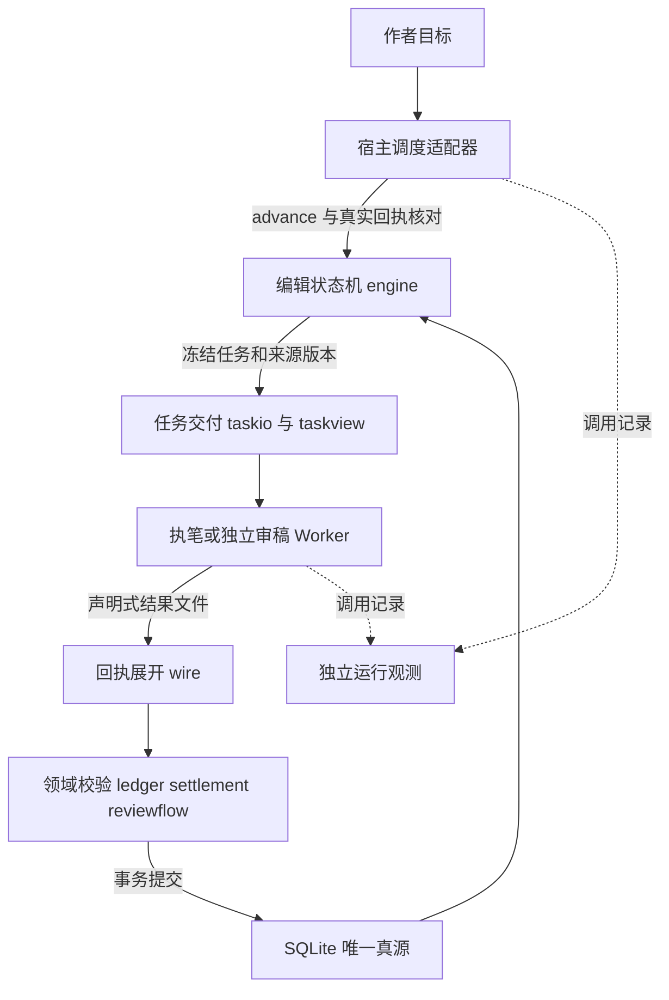

# 小说引擎交互架构改造设计

状态：v1.55.0 已实施领域契约同源、新任务时间坐标与反证核验；v1.54.0 单章策略和 v1.53.0 交互修复保留。适用范围：novel-ledger-v2 的任务交付、证据回执、时间计划和宿主调度。本文补充 [现有架构契约](architecture.md)，运行字段以 [协议](protocol.md) 为准。

改造目标是减少模型为找字段、计算坐标、检查状态和修复机械格式而产生的往返。SQLite 继续保存唯一事实，模型继续负责创作和语义审稿，引擎负责确定性计算。v1.53.0 的首版保留三章批次以诊断交互冗余；以下保留当时的依据，当前唯一执行流程以 v1.54 单章执行节为准。

## 现状与设计依据

完整运行日志的主会话及 20 个子会话合计 99,109,111 token，其中非缓存输入 8,437,679、缓存读取 89,909,974、输出 761,458。分析会话自身另消耗 2,852,462 token，不混入小说运行成本。[逐会话统计](../docs/antigravity-token-audit-2026-10-12.json)记录来源路径和文件哈希。

最后两名审稿者分别进行了 93、103 轮模型调用，其中 61、65 轮包含证据定位命令。最后一名执笔者进行了 44 次短脚本调用，涉及资料探查、SQL 试错、源码阅读和回执组装。当前问题集中在交互次数和历史重复输入。

现有 `ledger.evidence` 已能给唯一引文补齐缺失的 `start`，但 `wire.expand_evidence` 的目录条目要求它必填，任务提示又优先引导单条定位。应统一这些入口，而非另建定位算法。两个 Skill 路径实际为软链接关系，不需要做双副本同步。

## 目标架构与权威边界



| 边界 | 决定什么 | 禁止承担的职责 |
|---|---|---|
| 宿主调度适配器 | 启动、等待、结束、恢复 Worker，记录宿主会话身份 | 直接改稿、修改领域门禁、根据 Worker 口头汇报推定入库 |
| engine | pending、提交、返修、修订分支和正式入库 | 根据 token 预算自动通过语义审稿 |
| taskio 与 taskview | 冻结材料、渲染当前阶段可读的任务视图 | 生成新剧情事实、删掉无法证明无关的材料 |
| wire | 协议引用展开和证据格式统一 | 生成 pass、模糊匹配后替换引文、改变结果含义 |
| ledger 与 settlement | 引文验证、事件应用、前态核对、资源和时钟结算 | 猜测作者接受的时间偏差 |
| reviewflow 与审稿者 | 首读冻结和独立的事实、读者检查 | 沿用他人首读作为自己的阅读事实 |
| 运行观测 | 记录调用、输入、缓存、输出及失败成本 | 调度故事任务或改变事实账本 |

保留唯一 pending。观测数据可异步采集，但不并行写有先后依赖的章节。新增模块须登记于架构层级测试；首版不拆分 engine 的全部状态机。

## 证据回执统一

### 输入协议

继续使用 `result/1` 外壳。通过任务能力标记 `evidence_input=quote_optional_start/1` 启用扩展，旧任务和旧证据格式继续有效。

```json
{
  "evidence_catalog": {
    "q1": {"chapter": 30, "quote": "第十一日深夜。"}
  },
  "facts": {
    "events": [
      {"op": "clock", "evidence": {"ref": "q1"}}
    ]
  }
}
```

上例只演示证据引用，事件业务字段仍按当前事件契约填写。普通内联证据同样允许省略 `start`。有效且精确匹配的显式坐标继续支持，以便定位重复引文。

### 提交流水线

1. 按当前规则绑定任务目录、`task_id` 和 `input_hash`，检查租约、分支、依赖签名与任务状态。
2. 保留当前原始传输回执的 `result_hash` 幂等语义；已完成任务重提同一结果直接返回，不重新查询已变化的材料。
3. 在事务内展开目录引用，仅遍历已登记的证据字段，不递归改写普通叙事对象中的 `quote`。
4. 将各章或文档的冻结文本解析一次，建立本次提交的来源表。同一来源和引文的重复检查复用定位结果。
5. 复用 `ledger.evidence` 的精确定位。只从当前任务允许的版本取正文；审稿用冻结候选稿，执笔用本次合成稿。不能按“当前正式章节”替代待审候选版本。
6. 对每条定位失败汇总字段路径、错误码、候选位置和修正出口。唯一命中自动填偏移，多处命中要求显式坐标或更长引文，缺失引文拒绝提交。
7. 继续执行全部事件、读者、事实和结算检查，成功后持久化展开后的回执。原始回执通过现有 wire 回执机制保留；`start` 的单位仍为 Python 字符位置。

`preflight` 与 `submit` 共用这条流水线，前者回滚且不计用量、不推进任务。失败汇总只能报告实际可验证的错误；依赖前序事件的错误继续标为 cascade，不能将其当独立事实。

`commands.evidence` 保留为歧义和排错工具。新任务不再将单条定位列为常规步骤；也不禁止 Worker 为真实疑点使用它。目录引用去重只减少机械重复，检查理由仍由审稿者逐项完成。

## 任务阅读视图

新增 L1 模块 `taskview.py`，消费 taskio 已冻结的记录并渲染，禁止向 engine 发起新的任务决策。taskio 仍负责物化和交付，视图是可重建的派生文件。

```text
task.json                 身份、阶段、版本、操作命令与首选阅读入口
input.json                机器索引和完整材料路由，兼容已有 Worker
reading.md                当前阶段必读完整记录的阅读视图
reading.manifest.json     记录来源、全文哈希、字段路径和覆盖关系
input/ 与 shared/         保留全部按需材料地址
result.template.json      当前阶段回执模板
```

`reading.md` 不是模型生成的摘要。它按任务目的展示完整必要记录，包括任务目标、约束、前态、章节计划、候选事件前缀和必读人物资料。只调整呈现顺序和结构，字段名称、来源版本和业务含义保留。正文沿用原文文件和哈希引用；不再在视图里复制一遍全文。

Worker 默认选择阅读视图；需要精确字段或排错时使用 JSON。已读且版本未变的完整记录，在同一 Worker 中可跳过重复视图段落。新 Worker 重新读取必要材料；manifest 只证明覆盖关系，不能证明模型已经读过。

超出宿主单次读取能力时，按完整记录拆为有序阅读页；不按字符裁掉事实，也不将一个完整记录静默截断。按需材料一直可补读。主控只获得 task 路径和短状态，不加载 reading 正文。

首读未冻结时，现有首读信封仅暴露允许的正文和首读模板，不生成或开放包含账本和作者设计的阅读视图。冻结后才物化完整视图。新增 `task-view --task ID` 命令登记为 SEALED，不能成为绕过首读的旁路。

交付成本同时计入索引、视图、必读页及按需补读。验收要求能从 manifest 重建完整输入，不允许只缩小索引却扩大实际必读量。

## 时间计划统一

新增 L1 模块 `schedule.py` 负责时间坐标解析和规范化；engine 负责接受计划，settlement 只检查规范化后的条件。

规划者使用明确的坐标语义。例如场景时间为：

```json
{"time": {"basis": "batch_anchor", "offset_days": 1}}
```

引擎从实际状态取得锚点，不让 Worker 自填或改写锚点，并生成：

```json
{
  "timeline": {
    "schema": "chapter-timeline/1",
    "basis": "batch_anchor",
    "anchor_clock": 7,
    "end_offset_range": [1, 2]
  }
}
```

上例表示章末时钟为 8～9；区间包含计划明确允许的弹性。`chapter_start` 则表示相对本章真实前态的推进量，`absolute_clock` 表示章末绝对范围。三种坐标统一转换为章末时钟条件，不能用 `match_delta OR match_anchor` 猜解释，也不再隐式追加一天。

规划期校验坐标类型、单位、区间顺序、场景顺序以及已有明确期限。远期实际前态尚未确定时，保留符号约束，执笔派发前根据真实候选前态具体化。正文是否符合时间事件仍由独立审稿和提交结算验证；不能只靠规划前置校验代替。

`D+8` 只有在明确采用相对锚点时才解释为偏移八天，不因数值较大直接拒绝。旧计划没有 basis 时不自动猜测：旧 pending 保留冻结输入，完成后通过可回滚的迁移记录明确解释；歧义交给规划或现有修订流程处理。

正文时间与计划冲突时，引擎返回计划坐标、实际前后时钟和修正出口。审稿者可判 fix，规划修正通过现有 replan 或修订路径落地，并复核后续依赖与期限。首版不引入审稿者自动改 clock 的能力。

## 宿主调度与会话生命周期

宿主适配器承担 `dispatch / wait / resume / close / record_usage`。它位于领域引擎外；CLI 的 `advance` 继续只生成任务，不声称能够启动模型。没有可调用的宿主 SDK 时，适配器由当前宿主主控执行这些工具动作，不能伪造一个 Python runner 去调用不存在的接口。

主控循环收敛为“取任务 → 派 Worker → 等真实结束 → advance --after 核对”。重复状态查询、正文阅读和回执拼装退出主控的正常路径。恢复继续使用 controller 快照、原 pending 和原输入哈希；恢复前确认旧 Worker 已结束。

逻辑批次继续控制顺序、整批首读、返修与验收。首版 writer 和 reviewer 均沿用批内连续会话。后续将物理会话粒度做成宿主策略，比较逐章新建与批内续接，不能修改任务验收粒度来省调用。

审稿会话拆分只有在新 Worker 能重新读取必要正文、保留真实冻结首读身份并完成跨章核验时才成立。它不能将上一名审稿者的首读冒称为自己的盲读。现有整批首读只有一个独立审稿者的语义，也不能因拆分改称多个独立盲审。

宿主确有清理历史能力时，可在已持久化提交的边界清理冗余工具输出。只支持新建会话时，按完整必要材料重建。单纯把文件外置不会删除已经进入模型历史的内容，不能计作历史压缩收益。

运行期拒绝热修引擎，诊断通过当前任务视图、事件契约和结构化错误完成。无内容的版本、真实路径及能力检查可由 doctor 提供，领域资料读取继续受 SEALED 守卫控制。提示词约束不等于权限隔离：只有宿主能限制工具、文件写入和任意命令执行时，才能声称阻止直接改库或源码；共享账号下的自由 shell 无法靠 CLI 守卫保证这一点。

## 观测与验收

观测记录单独保存，不改变故事事实或任务决策。引擎继续报告交付字节和回执体量，宿主提供真实 token。按 `(provider, session_id, request_id)` 去重；没有 request_id 时记录导出来源与 step_index，不拼接完整、精简和分块日志重复累计。

每次模型调用记录角色、阶段、关联 task_id、非缓存输入、缓存输入、输出、耗时、工具类别和错误码。缺失 token 用 null 表示，不将字节换算成精确 token。Gross 是各项 token 之和，费用另按宿主实际计价规则核算。一个调用关联多个任务时保留多任务关联，不强行平均分摊。

观测失败不阻止已成功提交的故事任务，但须留痕；观测未完整时不发布精确降耗结论。

| 实施批次 | 具体改动 | 验收条件 |
|---|---|---|
| A 证据协议 | wire 接受可选 start；统一 proof 字段遍历；taskio 修改提示和模板；复用 ledger 定位 | 普通与目录证据行为一致；缺失、重复、错版本引文拒绝；preflight 零持久副作用；重提幂等保持 |
| B 阅读视图 | taskview、覆盖 manifest、首选阅读入口、SEALED task-view | 首读隔离保持；所有必读完整记录可重建；阅读视图与 JSON 不双重强制；delivery_probe 比较实际交付 |
| C 时间协议 | schedule、新计划时间字段、派发前具体化、明确迁移规则 | 批次相对、单章推进、绝对时间分别验证；计划歧义拒绝；后续时钟与到期承诺回归通过 |
| D 运行观测 | 会话与任务关联、调用去重、阶段汇总 | 可复算现有日志总量；未知用量显式保留；观测故障不影响事实事务 |
| E 会话策略 | 宿主适配和生命周期配置，比较一章与三章 | 同模型、同材料、同目标下比较调用次数、重新读入量、失败率、token 与跨章质量 |

先交付 A，再交付 B；时间语义修复 C 独立验证，不与证据降耗混成一个收益数字。D 在实际对比运行前具备，E 在 A、B 已测量后决定默认值。

回归覆盖正常三章批次、单章局部返修、引文歧义、计划时间冲突、中断恢复和历史修订。修改涉及的领域测试通过后执行全量现有测试；交付改动运行 delivery_probe。真实模型对比要包含重新加载和失败返工成本，质量检查覆盖事实、文风与跨章承接，避免只优化 token 数。

## 兼容与上线顺序

新增能力只影响新建任务。已有 pending 的 task.json、输入、首读、命令与哈希不改写。先支持新旧证据输入，再生成新模板；阅读视图可从冻结输入重建，失败时带原因降级到现有 JSON 入口。任何新命令须先登记访问级别。

时间协议产生新的领域约束，必须版本化，记录迁移前后计划、解释 basis 和依赖重算结果。旧任务用旧解释完成后再切换；已经存在歧义或热修行为的项目先在副本重放验证。不能重新解释已验收章的日程后仍沿用原审结论。

回滚关闭新任务能力生成，已冻结的新协议任务继续由兼容实现处理。停止一个新特性不删除正文、任务、回执或首读事实。原 settlement.py 的双解释补丁已由 schedule 单一坐标校验替代；旧 day_span 保留文档既定的章首推进语义。旧计划的人工迁移继续使用现有 replan 或修订流程，不自动重解释历史章节。

## 首版验证结果

证据目录与内联证据已统一，可省略偏移，保留原始回执幂等与历史因果来源；约定义务仍由 reviewflow 汇总结构和原文错误。taskview 按完整记录渲染并提供可重建 manifest，首读前不开放，失败时明确降级到 JSON。schedule 为新时间约束编译明确坐标，保留旧任务语义。hostflow 生成真实派工规格，writer_session_policy 提供 batch/chapter；观测工具能复算原运行的 99,109,111 token。

[交付探针](../docs/interaction-delivery-2026-10-12.json)对同一冻结输入比较 JSON 来源与阅读视图，覆盖 15 个已解锁阶段样本：必读来源 356,599 字节，视图 328,680 字节，降低 7.83%；文件读取由 87 次降为 20 次。未冻结首读另按原正文通道执行，不混入这组资料视图统计。旧探针会重复计算共享分片，又漏计部分必读字段；legacy_required_read 仅保留作旧口径诊断，新比较使用来源文件去重后的口径。

[会话策略基准](../docs/interaction-policy-2026-10-12.json)用三个相同工程章节执行生成的提交命令：batch 为 1 名执笔与 1 名独立审稿，chapter 为 3 名执笔与 1 名独立审稿，正式正文和账本状态哈希相同、审计均通过。v1.53.0 当时默认保持 batch；v1.54.0 按作者要求已统一为单章写审。该基准没有调用模型，实际 token、耗时及文学质量收益仍须真实写作验证；不能据文件读取次数直接宣称 token 下降相同比例。

## 工程资料

[Anthropic 工具设计](https://www.anthropic.com/engineering/writing-tools-for-agents)支持合并频繁串联的机械操作，并同时测量调用次数、错误和 token。[上下文工程](https://www.anthropic.com/engineering/effective-context-engineering-for-ai-agents)讨论压缩与持久记录，也指出过度压缩可能丢失关键上下文。本设计据此选择先减少交互，再验证会话切分的实际收益。

[Google 缓存说明](https://ai.google.dev/gemini-api/docs/caching)说明缓存命中能降低成本。因此缓存 token、非缓存 token 和实际费用分别报告，不把原运行的 9911 万 Gross token 当作同等数量普通输入计价。

## v1.54 单章执行的全局改造

执行粒度与规划、复核粒度分离。execution.py 是 L0 执行策略唯一权威；所有项目统一 single_chapter，将有效批次固定为一章，复用已有逐章状态机，不创建空壳一章批次或临时事实账本。旧 v2 项目打开即自动备份升级；旧参数不激活旧模式。当前 pending 先按冻结协议完成后结束，升级转为 complete 时归档旧批次，保留正文与尝试次数逐章独立重审。

每个新任务冻结 chapter-execution/1：任务作用域、角色、会话寿命和主控交接归属。执笔只提交正文、摘要和具体自查，正式事件由独立综合审稿重建；提交不返回下一任务。综合审稿先正文首读、冻结后才取得账本和约定，同一审稿 task 与审稿者完成两类全部核验。fix 后保留原阶梯，新的返修和复审任务各自新派；单章模式不使用执笔任务复用历史审稿的 fast_commit。

controller 快照按 task_id 绑定执笔身份，任务或角色变化清理旧 ID 与章号集合，保留作者目标。可选真实 session 回报拒绝已知跨任务复用；已绑定的首读与正式审稿须同会话。未报告身份时只证明任务顺序，不证明宿主隔离。已绑定审稿者无法恢复时取消任务后重新独立首读，不能借用别人的阅读事实。

滚动章纲、十章/卷末/修订/全书复核、作者定调及授权终止范围照常。跨章复核仍可在独立 review_session 内连续处理完整分块；额外材料任务仍按来源需要出现。统一模式依据作者指定的一章一写审目标和故障影响范围，不根据工程字节指标宣称模型 token 更少。单章会话增加派工与资料重读，真实降耗与文学质量仍待实际同模型运行对比。

验收覆盖 W2→R2→W3→R3 顺序、首读门禁、返修保留次数、会话身份与恢复标记、旧库与旧批次、禁止中途改模式、十章复核和作者门禁；工程基准比较相同正文与事件的两种模式。

[单章执行工程基准](../docs/single-chapter-execution-2026-10-12.json)对三章相同正文与事实比较旧批次和新流程，正式正文与账本哈希一致、审计通过；新流程为三次执笔与三次综合审稿。旧批次仅在隔离的历史工程夹具中重放，不是可选运行模式。真实 token 为 null，文学质量未测量。

## v1.55 领域契约与恢复改进

依据会话 26526a81 的[审计快照](../docs/antigravity-26526a81-audit-2026-10-12.json)，问题在于交付和守卫的契约错位：规划按整批日期写 D+2，兼容验证器按章首推进；审稿再按错误允许范围修改 clock。材料和证据已有完整交付与自动定位，但不同提示层仍让 Worker 重读、查库和重写回执。

权威保持在已有领域模块：schedule 提供时间坐标、计划示例和拒绝恢复；wire 提供可选 start 的证据契约；reviewflow 提供关键检查的反证核验；taskio 与 memory 引用这些事实，engine 只按冻结能力编排。新能力在任务签发时进入输入哈希，不热改旧 pending，不增加第二套账本、审稿状态机或时间解释器。

新规划的硬日程须 explicit-time-input/1，拒绝仅用 D+N/day_span/day_anchor 的回执。模板直接给 time/timeline；整批倒计时声明 batch_anchor，普通叙事提示仍自由。已有冻结日程不猜原意；冲突通过审稿 fix 和修订处理，拒绝恢复给出 owner/action/finding 提示，不生成自动 pass 或替作者改稿。

新审稿按 review-scrutiny/1 为 time/language 检查选反证，解释 risk 和必要性；time 的 elapsed_days 与正式主线结算交叉核对。仅改 clock 而保留原天数声明会被拒绝；模型同时伪造声明和理由仍可能漏检，必须由独立语义审稿核实，不能承诺程序识别所有时间矛盾或非必要形容词。

commands.read 是通过同一首读门禁的一次必读记录读取，与分页面二选一。它核验来源、页、manifest 和记录值，不截断内容、不替模型阅读。小记录不重复附来源元数据，完整 provenance 留在 manifest；较大记录保留哈希支持同 Worker 复用。少量回执修正改结果文件即可，不重生成整份脚本。

[交付基准](../docs/architecture-delivery-2026-10-12.json)验证全部必读记录相等、最终正文与账本相同，分别计读页次数、一次读次数和实际交付字节；不将这些计数换算 token/费用。小任务本来只有一页时，不能声称减少调用次数。宿主缓存与主控历史需 checkpoint 和宿主支持的交接处理，skill 不自动创造新主控或推断授权。
