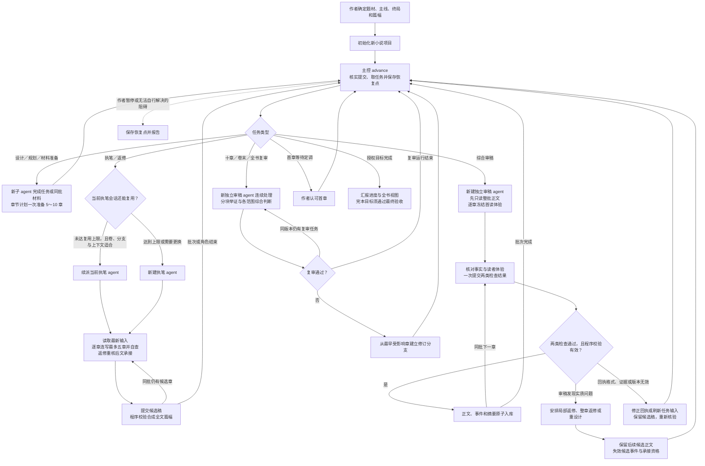
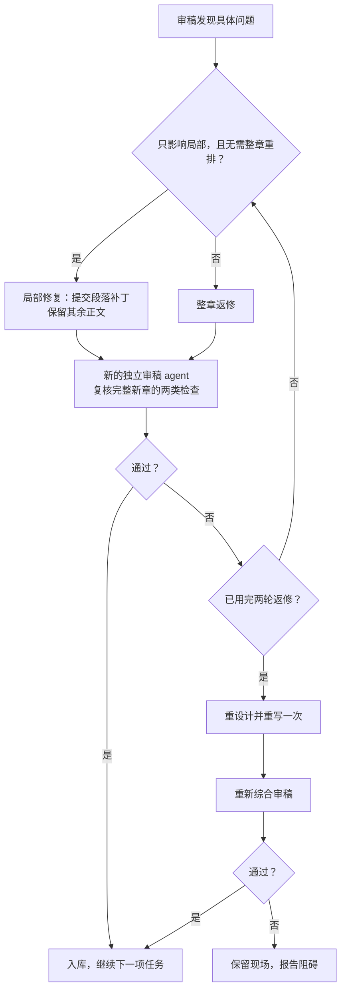

# Skill 流程图
何时读：先用图看懂派工、批次执笔与密封审稿的整体关系。

下图展示主控派工、引擎校验与返修的关系；调度细节见 [runtime](runtime.md)。

常规交接只需主控等待 Worker 结束，再调用 `advance --after 最后已提交任务ID`；返回下一信封后直接派工。完整结构化资料默认直接交付，常规五章按两次主控派工完成连续执笔、自查和新审稿者的逐章独立核验；长材料由一个 Worker 在同一批次内连续准备。执笔提交时由程序核验篇幅，独立审稿先冻结首读，再一次提交事实与读者两类检查。准备与返修按任务需要出现。

## 主流程

## 局部返修与重设计

十章复审按已入库章号触发，独立于执笔会话批次；全部分段审读完成后再综合复核。

具体操作与约束以 [运行与调度](runtime.md)、[审稿与完本](editorial.md)、[局部修订](repairs.md) 和 [任务协议](protocol.md) 为准。
