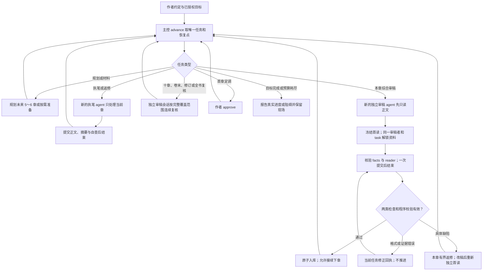
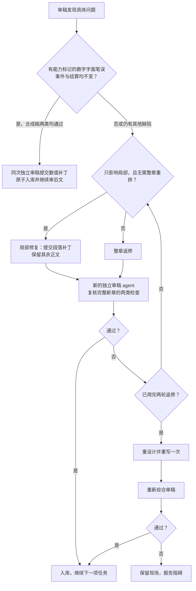

# Skill 流程图
何时读：先用图看懂派工、单章写审与首读冻结的整体关系。

下图展示主控派工、引擎校验与返修的关系；调度细节见 [runtime](runtime.md)。

无人值守统一单章写审：一个新的执笔 agent 写一章，一个新的独立综合审稿 agent 完成本章的读者与事实核验，通过后再写下一章。滚动章纲和跨章复审独立运行；材料和返修按需出现。旧 v2 项目自动备份升级，当前冻结任务完成后切入同一流程；见 [runtime](runtime.md)。

## 主流程

主控在 Worker 真实结束后使用 advance --after 核对提交。首读解锁不是另一次派工；宿主身份未知时不宣称历史隔离已验证。

## 局部返修与重设计

十章复审按已入库章号触发，独立于执笔会话；全部分段审读完成后再综合复核。

具体操作与约束以 [运行与调度](runtime.md)、[审稿与完本](editorial.md)、[局部修订](repairs.md) 和 [任务协议](protocol.md) 为准。
